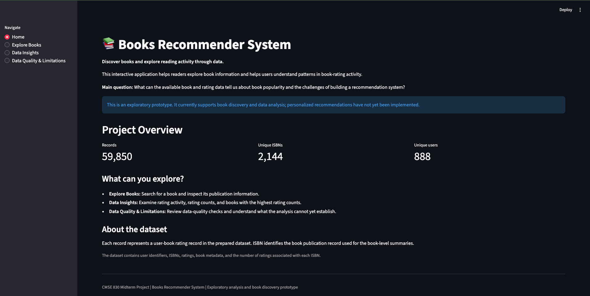
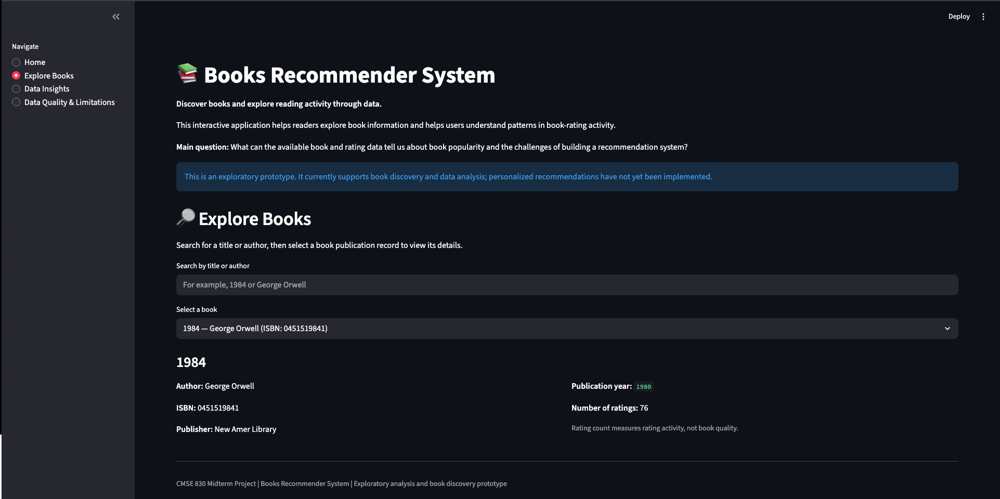
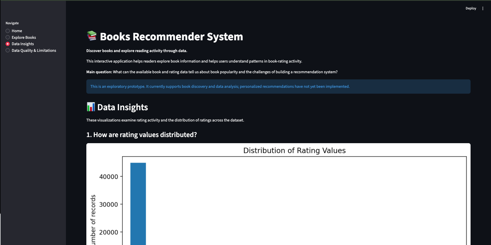
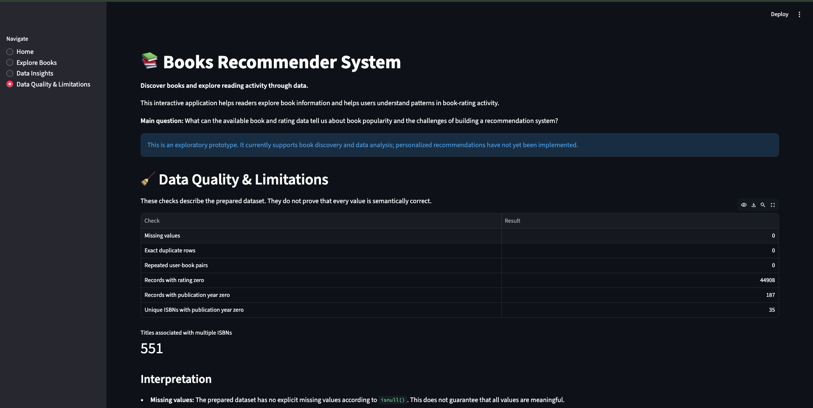

# Books Recommender System

## Project Overview

The Books Recommender System is an individual CMSE 830 midterm project at Michigan State University. It explores book metadata and rating activity through an interactive Streamlit application.

**Current status:** The application supports book discovery, exploratory data analysis, and data-quality checks. Personalized book recommendations have not yet been implemented.

## Audience

The intended audience is readers interested in exploring book information and people interested in understanding how rating data can support the development of a recommendation system.

## Main Analytical Question

What can the available book and rating data tell us about book popularity and the challenges of building a book recommendation system?

## Dataset

The prepared dataset, `clean_data.csv`, contains 59,850 records and nine columns:

- `user_id`: user identifier
- `ISBN`: book publication identifier
- `rating`: recorded rating value
- `title`: book title
- `author`: author name
- `year`: publication year
- `publisher`: publisher name
- `image_url`: book image URL
- `num_of_rating`: number of ratings associated with the ISBN

The current dataset contains 2,144 unique ISBNs and 888 unique users.

**Dataset access:** The CSV file is not included in this repository at present. To run the project, obtain the prepared `clean_data.csv` file and place it in the `data/` directory alongside this README and `app.py` in the project folder structure described below.

## Key Findings

- The dataset contains 59,850 records.
- 44,908 records (75.03%) have a rating value of zero, while 14,942 (24.97%) have nonzero ratings.
- No explicit missing values, exact duplicate rows, or repeated user–ISBN pairs were found in the prepared dataset.
- There are 187 records across 35 ISBNs with publication year recorded as zero.
- Some titles are associated with multiple ISBNs, which may represent different editions or publication formats.

These are descriptive findings. The meaning of zero ratings and publication year zero must be verified before drawing stronger conclusions.

## Application Features

- Dataset overview with record, ISBN, and user counts
- Book search by title or author
- Book metadata exploration
- Rating distribution visualization
- Comparison of zero and nonzero ratings
- Distribution of rating counts across ISBNs
- Top ISBNs by number of ratings
- Data-quality checks and limitations

## Project Structure

```text
books-recommender-system/
├── app.py
├── README.md
├── requirements.txt
├── data/
│   └── clean_data.csv
├── notebooks/
│   └── Books_Recommender_EDA.ipynb
└── screenshots/
```

## Requirements

- Python 3
- pandas
- Streamlit
- Matplotlib
- Jupyter Notebook and NumPy for the EDA notebook

## Setup and Run

1. Clone the repository:

   ```bash
   git clone https://github.com/hariharakrishna-code/Foundations-of-Data-Science-CMSE830.git
   ```

2. Open the project folder:

   ```bash
   cd Foundations-of-Data-Science-CMSE830/projects/books-recommender-system
   ```

3. Create and activate a virtual environment:

   ```bash
   python3 -m venv .venv
   source .venv/bin/activate
   ```

4. Install application dependencies:

   ```bash
   pip install -r requirements.txt
   ```

5. Obtain `clean_data.csv` and place it in the project's `data/` directory.

6. Start the application:

   ```bash
   streamlit run app.py
   ```

7. Open the local URL displayed in the terminal.

**Important:** The app's dataset-loading code must support the `data/clean_data.csv` path for these instructions to work as written.

## Limitations and Future Work

- Personalized recommendations are not implemented yet.
- The meaning of zero ratings needs verification.
- Publication year values of zero need investigation.
- Multiple ISBNs may correspond to the same title.
- Rating counts indicate activity, not necessarily reader satisfaction.
- A future recommendation method should be evaluated before its recommendations are presented as reliable.

## Analysis Notebook

The exploratory analysis notebook is located at `notebooks/Books_Recommender_EDA.ipynb`. It documents the dataset inspection and visualizations supporting the application.

## AI Use Disclosure

Document any generative AI assistance used in debugging or running the Streamlit application, following the course's disclosure requirements. The project's analysis, decisions, and interpretation should be described accurately.

## Author

Hariharakrishna Navaneethakrishnan

## Repository

https://github.com/hariharakrishna-code/Foundations-of-Data-Science-CMSE830


## Application Screenshots

### Home


### Explore Books


### Data Insights


### Data Quality and Limitations

